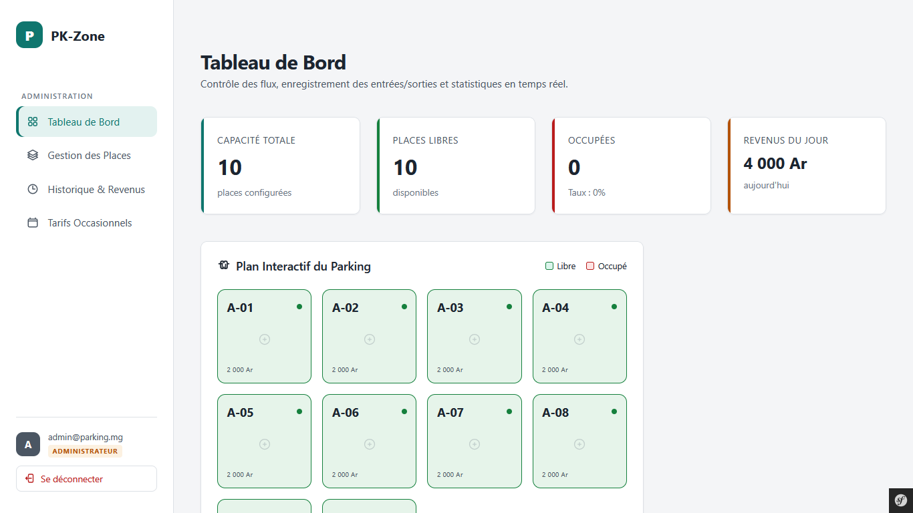
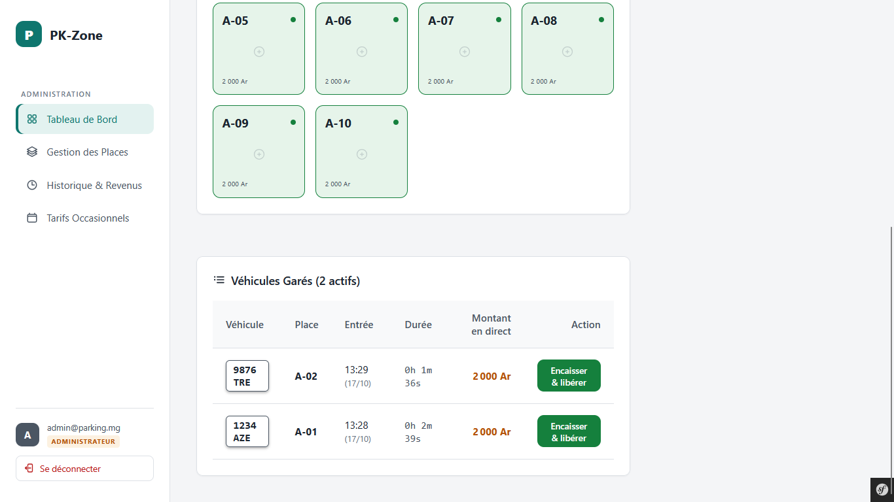
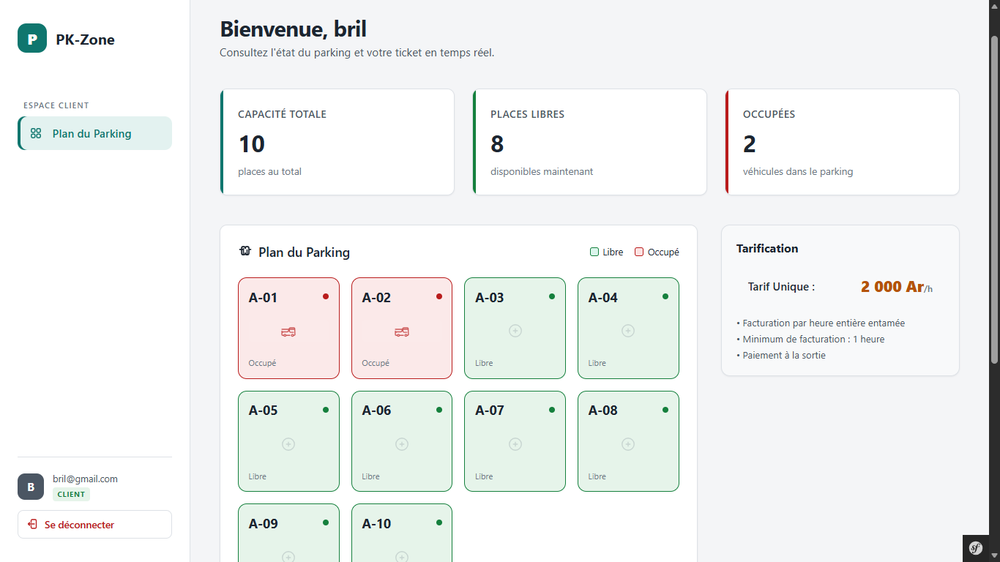
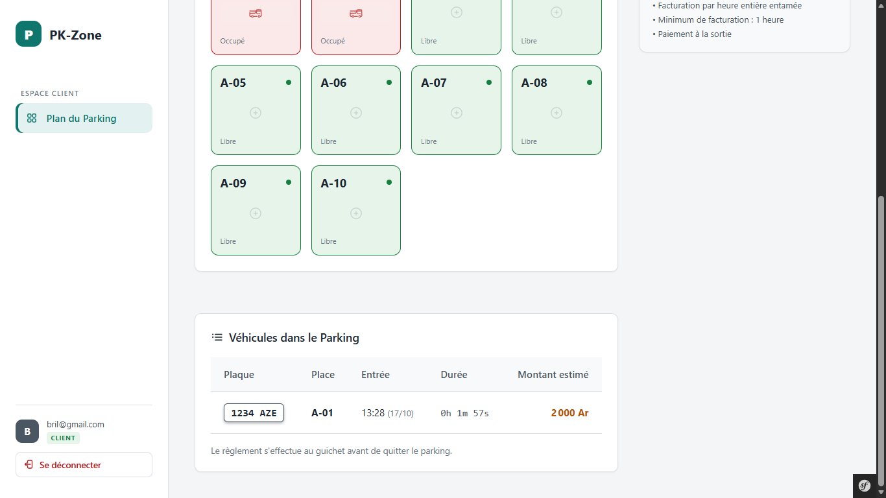
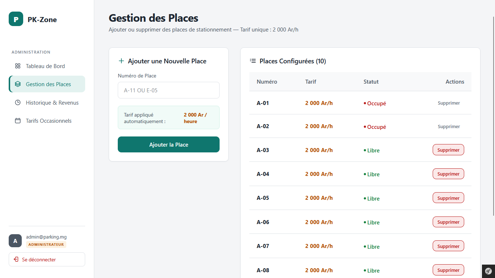
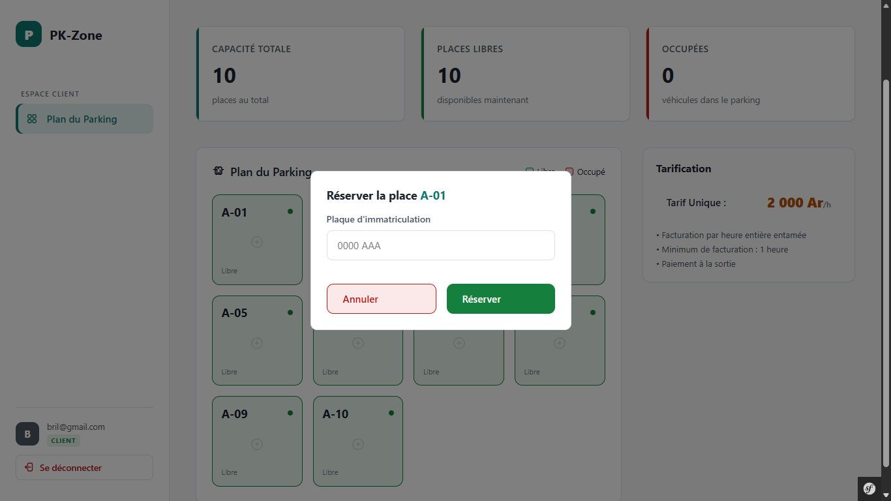
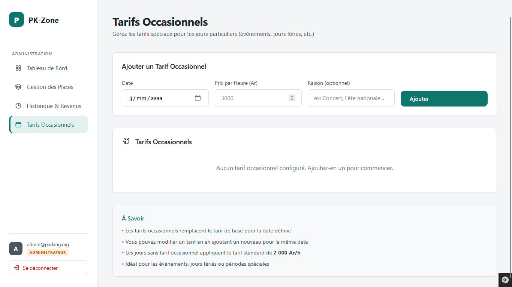
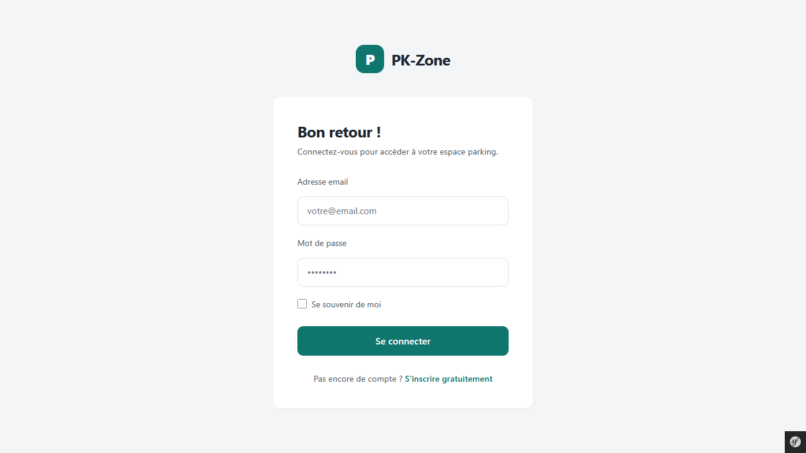
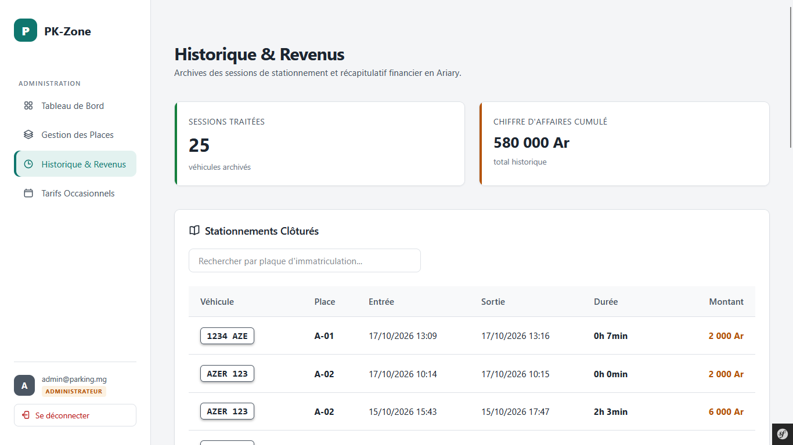

# PK-Zone — gestion de parking

PK-Zone est une application web de gestion de parking pensée pour les petits parkings : réservation de place par les clients, suivi des véhicules en temps réel, tarification à l’heure et historique des paiements pour l’administrateur.

 |


## Aperçu

| Client | Administrateur |
|---|---|
|  | |
|  |
|  |  |
|  |  |

## Fonctionnalités

**Client :** inscription et connexion, réservation d'une place libre depuis le plan, suivi de sa session en direct.

**Administrateur :** tableau de bord (statistiques et plan en temps réel), gestion des places, tarifs occasionnels par date, encaissement et libération des places, historique et revenus.

## Technologies

PHP 8.4, Symfony 8.1, Doctrine ORM, Twig, MySQL/MariaDB

## Audit et corrections

Après la première version de l'application, j'ai mené un audit de sécurité
et de fiabilité du code. Voici ce que j'ai trouvé et corrigé :

| Problème trouvé | Correction |
|---|---|
| Un client voyait toutes les sessions et pouvait clôturer celles des autres | Relation session ↔ client, affichage filtré côté serveur ; la clôture est désormais réservée à l'administrateur |
| Aucun jeton CSRF sur les formulaires | Jeton unique par action, vérifié côté serveur |
| Doubles réservations et doubles paiements possibles | Transaction avec verrou pessimiste (`SELECT ... FOR UPDATE`) |
| Le client se déclarait lui-même « payé » | Encaissement réservé à l'administrateur (route protégée) |
| Supprimer une place effaçait l'historique des paiements | Suppression refusée si la place a un historique |
| Connexion sans limite de tentatives | Limitation à 5 tentatives par 15 minutes (`login_throttling`), mot de passe de 8 caractères minimum |
| Migrations incomplètes (table `user` absente) | Migration ajoutée, schéma reconstruit depuis une base vide |
| Calcul du tarif copié à plusieurs endroits | Service `ParkingBillingService` unique |
| Validations uniquement côté navigateur | Contrôles côté serveur (plaque, numéro de place, prix) |
| Heures décalées de 3 h (serveur en UTC) | Fuseau `Indian/Antananarivo` fixé dans le noyau de l'application |
| Interface sombre, peu lisible et inutilisable sur mobile | Thème clair sobre et interface responsive (menu en barre du haut, tableaux défilants, grilles adaptatives) |

## Installation locale

Prérequis : PHP ≥ 8.4 (avec l'extension `pdo_mysql`), Composer, MySQL ou MariaDB.

```
git clone https://github.com/Brillando78/PK-Zone.git
cd PK-Zone
composer install
```

Crée un fichier `.env.local` avec ta connexion à la base. Adapte `serverVersion`
au type de serveur que tu utilises :

| Serveur | Valeur de `serverVersion` |
|---|---|
| MySQL 8 | `8.0` |
| MariaDB ou XAMPP | `mariadb-10.4.32` (remplace par ta version, affichée dans phpMyAdmin) |

Exemple avec MariaDB (XAMPP) :

```
DATABASE_URL="mysql://root:@127.0.0.1:3306/parking_management?serverVersion=mariadb-10.4.32&charset=utf8mb4"
```

Cette valeur est importante : si elle ne correspond pas à ton serveur, les
migrations échouent avec l'erreur « The metadata storage is not up to date ».

```
php bin/console doctrine:database:create
php bin/console doctrine:migrations:migrate
php bin/console app:create-admin admin@example.com MotDePasse123   # crée le compte administrateur
php bin/console app:init-parking                                   # crée des places de démonstration
php -S 127.0.0.1:8000 -t public
```

Le compte `admin@example.com` est un exemple pour un usage local : choisis ton propre mot de passe.

## Premiers pas

1. Ouvre http://127.0.0.1:8000 et connecte-toi avec le compte administrateur : tu arrives directement sur le tableau de bord.
2. Pour tester côté client, déconnecte-toi puis crée un compte sur `/register`, réserve une place depuis le plan, puis reconnecte-toi en administrateur pour encaisser la session.

## Limites connues et pistes d'amélioration

### Limites actuelles

- **Paiement manuel** : l'encaissement est enregistré par l'administrateur au guichet. Il n'y a pas de paiement en ligne (mobile money, carte), et le mode de règlement n'est pas enregistré.
- **Un seul type de place** : le champ `type` existe, mais seul le type « standard » est proposé (pas de places électriques ou réservées aux personnes à mobilité réduite).
- **Tarification simple** : un tarif horaire unique, modifiable pour des dates précises. Toute heure entamée est due, avec un minimum d'une heure. Il n'y a pas de forfait journalier, d'abonnement ni de tarif par type de place.
- **Places non désactivables** : une place qui a déjà servi ne peut pas être supprimée, pour préserver l'historique, mais on ne peut pas non plus la déclarer « hors service ».
- **Statut des places stocké à part** : l'état d'une place (libre ou occupée) est enregistré indépendamment des sessions. Une modification manuelle en base peut les désynchroniser et laisser une place bloquée.
- **Pas d'annulation** : un client ne peut pas annuler une réservation faite par erreur. La clôture par l'administrateur facture au minimum une heure, même en cas d'erreur de saisie.
- **Une plaque, deux places** : le verrou en base empêche deux véhicules d'occuper la même place, mais pas qu'une même plaque soit réservée sur deux places au même instant (il faudrait une contrainte d'unicité).
- **Comptes** : pas de confirmation d'adresse e-mail ni de réinitialisation du mot de passe. Le message affiché après trop de tentatives de connexion est en anglais (message par défaut de Symfony).
- **Historique non paginé** : toutes les sessions terminées sont chargées d'un coup, ce qui ralentirait avec un gros volume de données.
- **Pas de tests automatiques** : les corrections ont été vérifiées manuellement.
- **Usage local** : le projet n'est pas déployé ni configuré pour la production (variables d'environnement, sauvegardes, HTTPS à prévoir).

### Pistes d'amélioration

1. **Tests automatiques** : accès refusé (403) pour un client sur les routes admin, protection contre les doublons, tests unitaires du calcul de tarif (`ParkingBillingService`).
2. **Désactivation des places** (champ `isActive`) à la place de la suppression.
3. **Statut des places déduit des sessions actives**, pour supprimer tout risque de désynchronisation.
4. **Paiement en ligne** par mobile money ou carte, avec confirmation avant clôture de la session.
5. **Contrainte d'unicité** sur la plaque des sessions actives.
6. **Statuts en enums PHP** (`active`, `completed`, `available`, `occupied`) à la place de chaînes de texte.
7. **Pagination et filtres de l'historique**, export CSV des revenus.
8. **Intégration continue** (GitHub Actions) pour lancer les tests et une analyse statique à chaque push.
9. **Reçus et notifications par e-mail**, réinitialisation du mot de passe.
10. **Rôles supplémentaires** (agent d'accueil / administrateur).